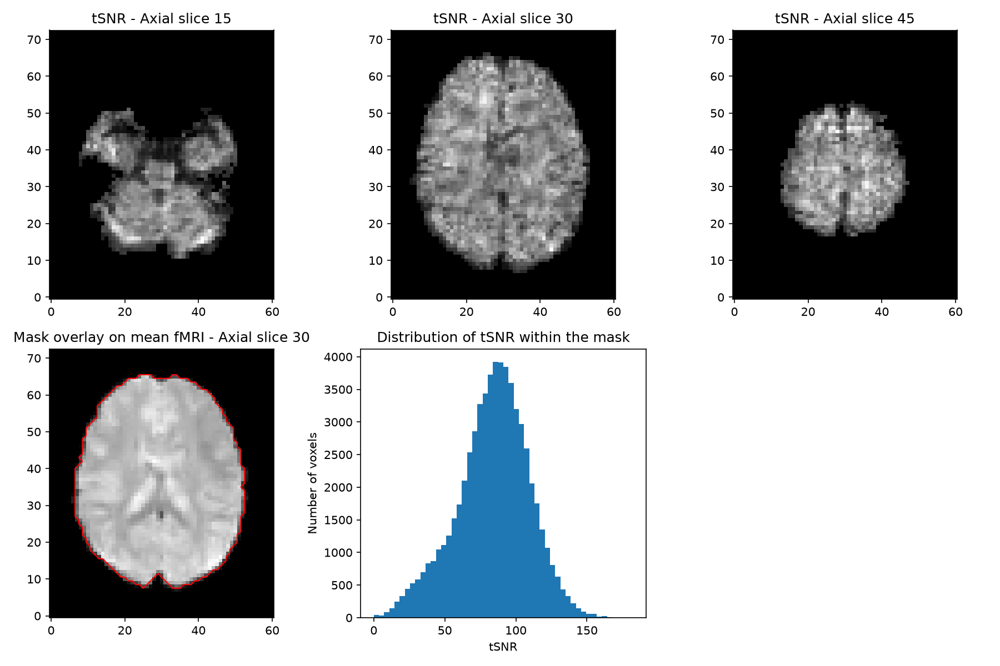

# fMRI Temporal SNR Quality Control
This project provides a basic quality control pipeline for resting-state fMRI data, focusing on temporal signal-to-noise ratio (tSNR).
It generates an EPI brain mask and calculates voxel-wise tSNR, along with summary statistics within the brain mask.
The pipeline produces a tSNR map, brain mask, statistical summary, and visual QC report.

## Installation
Developed and tested with Python 3.13.0

1. Clone the repository and open the project folder

2. Create a virtual environment:

```powershell
python -m venv .venv
```

3. Activate the virtual environment (Windows PowerShell):

```powershell
.\.venv\Scripts\Activate.ps1
```

4. Install the required packages:

```powershell
python -m pip install -r requirements.txt
```

## Usage

Download a 4D fMRI NIfTI dataset and place it in the `data/` directory. The following example uses a publicly available dataset from ADHD-200.

```powershell
python fmri_qc.py data/adhd/data/0010042/0010042_rest_tshift_RPI_voreg_mni.nii.gz --out outputs --discard 5
```

`input` - The path to the input 4D fMRI NIfTI file (required)

`--out` - The directory for the QC results (default: `outputs`)

`--discard` - Number of initial volumes to discard (default: `5`)

## Outputs

`tsnr_map.nii.gz` - NIfTI image of the tSNR map

`mask.nii.gz` - NIfTI image of the generated brain mask

`qc_summary.json` - A statistical summary including mean, median, standard deviation, 5th and 95th percentiles of brain-masked tSNR, mask voxel count, number of volumes used, and TR 

`qc_report.png` - A figure including three axial tSNR slices, a mean image with the mask outline and a tSNR histogram

## Example QC Report



## Method

The first N volumes are discarded before calculating tSNR (default N = 5) to exclude potentially unstable initial MRI signals. The effect of discarding different numbers of initial volumes can also be compared as an additional QC check. An EPI mask is generated using Nilearn `compute_epi_mask()`. tSNR is calculated voxel-wise across the image as the temporal mean divided by the temporal standard deviation. The summary statistics are then calculated using only the tSNR values within the generated brain mask.

$$
\mathrm{tSNR} = \frac{\mu_{\mathrm{time}}}{\sigma_{\mathrm{time}}}
$$

In the example dataset, discarding the first five volumes slightly increased the mean brain-masked tSNR from 83.71 to 84.06.

## Limitations

tSNR is computed on the data as given. The tool does not perform motion correction, detrending or nuisance regression, so values depend on whether the input has been preprocessed. Results from raw and preprocessed data are not directly comparable.

## Next steps

- Framewise displacement from realignment parameters

- Optional detrending before the tSNR calculation

- BIDS-compatible input handling


#### Status: early version, under development 

## Author

Kamand Senemmar